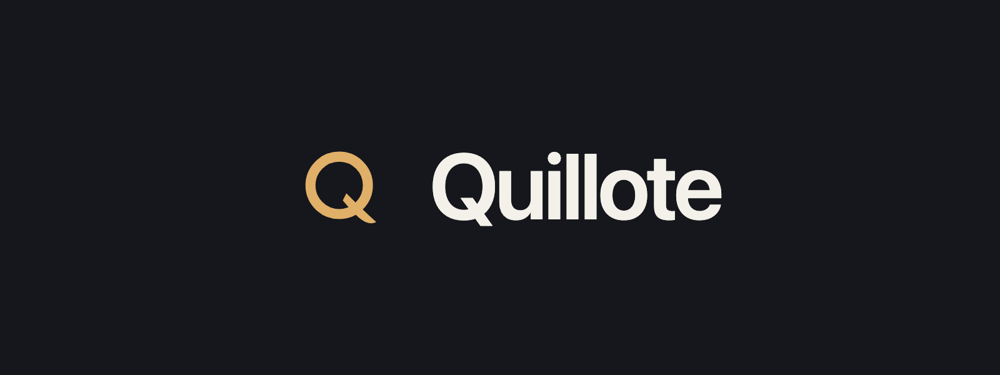
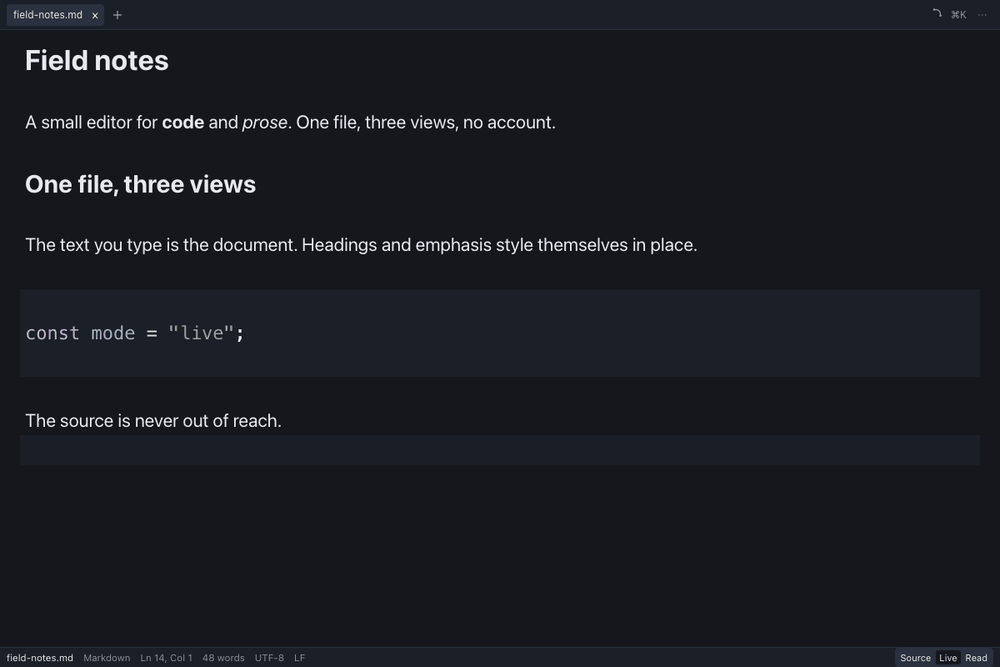
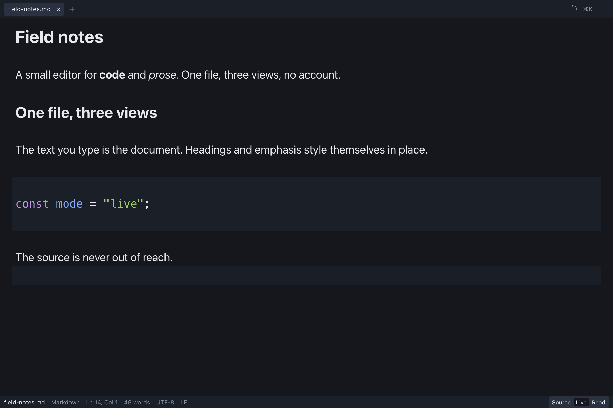
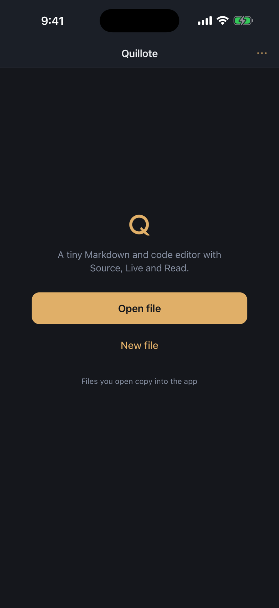
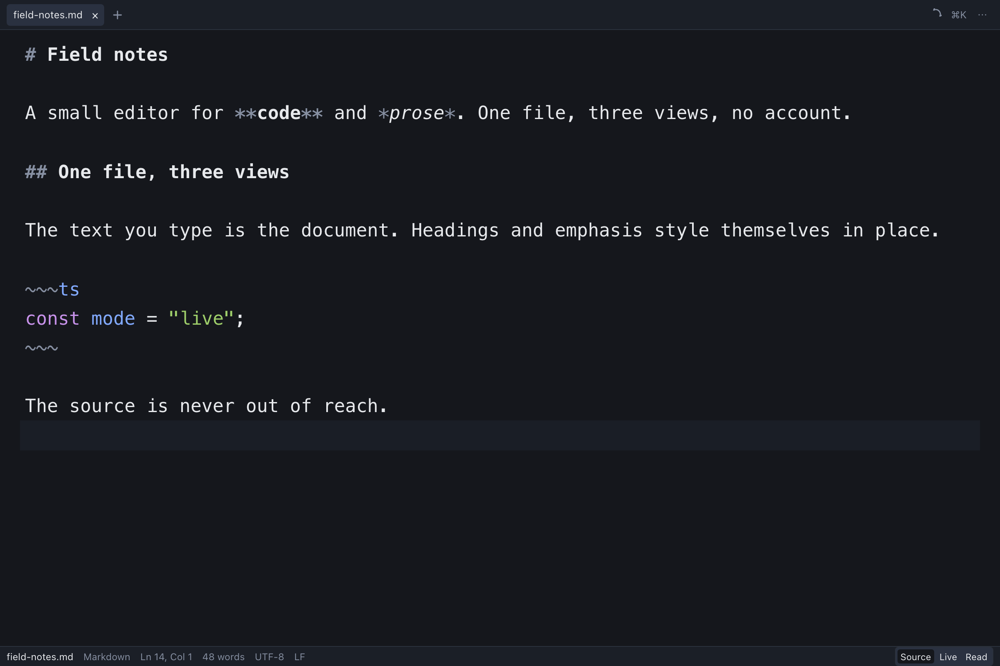
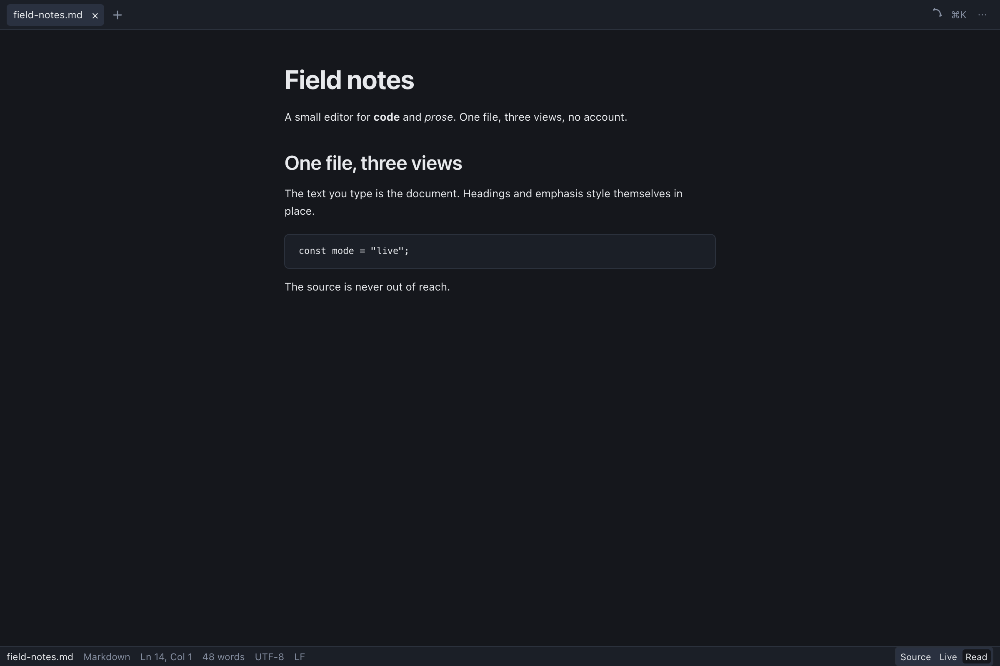
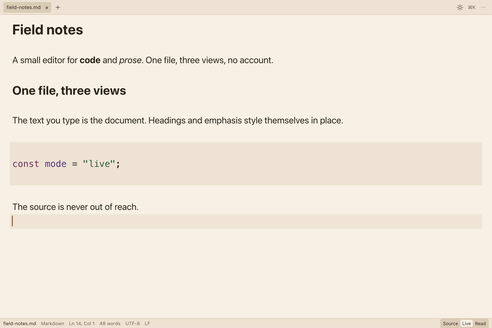
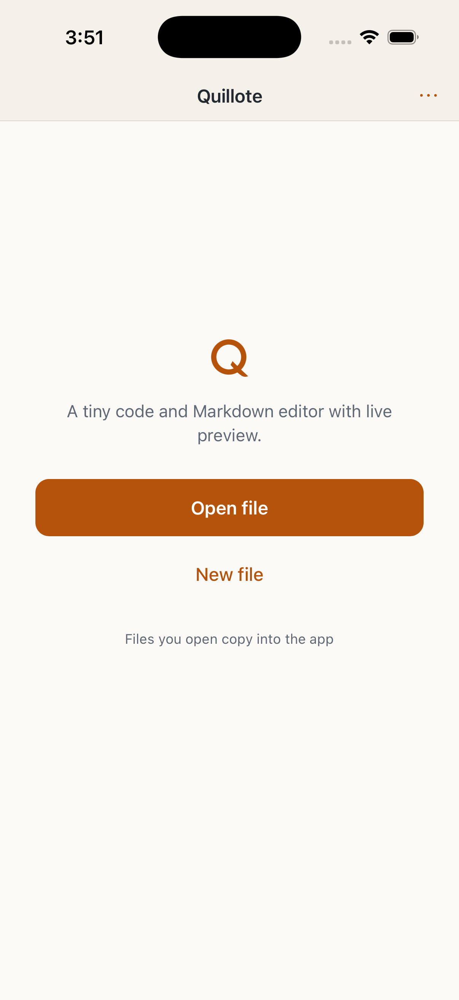

<p align="center">
  
</p>

<h1 align="center">Quillote</h1>

<p align="center">
  <strong>Write Markdown. Watch it take shape.</strong><br>
  A tiny Markdown and code editor with a real Live mode. 5.2 MB on your Mac, 7.2 MB on Android. Your files stay on your disk.
</p>

<p align="center">
  
  
  
  
  
  
</p>

<p align="center">
  
  
  
  
</p>

<p align="center">
  <a href="https://github.com/eulogik/quillote-site/releases/latest"><strong>Download the beta</strong></a>
  &nbsp;·&nbsp;
  <a href="https://eulogik.github.io/quillote-site/">Website</a>
  &nbsp;·&nbsp;
  <a href="https://quillote.com">quillote.com</a>
</p>

<p align="center">
  
</p>

<p align="center">
  <sub>Live mode, recorded in the app at normal speed. <a href="assets/img/quillote-live.mp4">Watch the MP4</a>.</sub>
</p>

## The hook is Live. The product is the file.

Most Markdown editors give you a text box and a preview somewhere else. Quillote gives you one buffer and three ways to see it. Live styles the file where you are typing. The Markdown never leaves.

- **Live** styles headings, bold, italic, inline code, links and fenced code as you type. The source is still there, under the styling.
- **Source** shows every character. The file is Markdown and nothing else.
- **Read** renders the finished page: tables, KaTeX math, images and links. KaTeX loads only when a document needs it.

The file on disk is always `.md` or plain text. No database, no proprietary document, no import step. Code files open in Source, with a real CodeMirror editor and around 100 languages.

## Download

| Platform | Build | Notes |
| --- | --- | --- |
| **macOS** | [Universal DMG, 5.2 MB](https://github.com/eulogik/quillote-site/releases/latest) | Apple Silicon + Intel, macOS 10.13+. Unsigned beta: right-click the app and choose Open the first time. |
| **Android** | [Signed APK, 7.2 MB](https://github.com/eulogik/quillote-site/releases/latest) | Android 7.0 (API 24)+, arm64. Sideload the APK; Play Store rollout is next. |
| **iPhone** | App Store build, signed | The archive is App Store-signed. TestFlight and App Store review are the next step. |
| **Windows** | GitHub release | CI-built NSIS and MSI installers, 2.1 MB and 2.6 MB. Unsigned; expect SmartScreen. |
| **Linux** | GitHub release | CI-built `.deb` and `.rpm`, 2.9 MB each. Unsigned. No AppImage: bundling WebKitGTK made it 82 MB. |

The [latest release](https://github.com/eulogik/quillote-site/releases/latest) has the files and SHA-256 checksums. The site is at [quillote.com](https://quillote.com), with a preview at [eulogik.github.io/quillote-site](https://eulogik.github.io/quillote-site/).

## Screenshots

| Desktop, Live | iPhone, first run |
| --- | --- |
|  |  |

<details>
<summary>More screenshots: Source, Read, and the Ink theme</summary>

| Desktop, Source | Desktop, Read |
| --- | --- |
|  |  |

| Ink, Live | iPhone, Ink |
| --- | --- |
|  |  |

</details>

## Why it feels different

- **One file, three views.** `Cmd/Ctrl+1`, `2`, `3`. The file never changes format. There is no split view to manage and no preview pane to sync.
- **A real editor.** CodeMirror 6, around 100 languages, line numbers, word wrap, language override, and a lazy grammar chunk per language. Markdown gets the same editor, not a textarea.
- **Small on purpose.** The universal macOS DMG is 5.2 MB. The initial JavaScript is 141.1 KB gzipped. The app CSS is 4.9 KB. Those are hard gates in the build, not launch-day claims.
- **Local by default.** No account, no analytics, no telemetry, no background network calls. Files stay in plain text on your disk.
- **The phone is a first-class target.** The same three views, a formatting bar above the keyboard, a file copied into the app sandbox, and edits exported through the share sheet. No write-back to a provider URL that might silently fail.
- **Built for the machine.** The system webview instead of bundled Chromium. A size-tuned Rust release profile. Keyboard-first on the desktop, touch-sized on the phone.

## Numbers that are gates

Every number is measured by `node scripts/check-size.mjs` and enforced in CI.

| Gate | Current | Limit |
| --- | ---: | ---: |
| Initial JS (entry chunk) | 141.1 KB gz | 200 KB gz |
| App CSS | 4.9 KB gz | 12 KB gz |
| Read renderer chunk | 39.8 KB gz | 60 KB gz |
| Largest other lazy chunk | 33.5 KB gz | 80 KB gz |
| KaTeX class, raw | 383.1 KB | 500 KB |
| macOS DMG, universal | 5.2 MB | 10 MB |
| Android APK | 7.2 MB | 15 MB |
| Linux .deb / .rpm | 2.9 MB | 10 MB |
| Windows NSIS / MSI | 2.1 MB / 2.6 MB | 10 MB |
| iOS IPA | 3.4 MB | 15 MB |

The tests: **277 frontend tests** in 19 files and **26 Rust tests**. `pnpm test`, `cargo test`, `tsc --noEmit` and Biome all run in CI.

## Site development

This public repository is the website. The app source stays private during the beta.

Preview locally:

```sh
python3 -m http.server 8080 --directory .
```

Open http://localhost:8080. There is no watch step. Edit the HTML or CSS and refresh.

Deploy:

```sh
rsync -a --delete /path/to/quillote/site/ /path/to/quillote-site/
cd /path/to/quillote-site
git add -A
git commit -m "site: update"
git push
```

A push to `main` runs `.github/workflows/pages.yml` and publishes with GitHub Pages. The preview is `https://eulogik.github.io/quillote-site/`. The custom domain is `https://quillote.com` once the DNS records are set.

At the registrar: apex `quillote.com` gets A records to `185.199.108.153`, `185.199.109.153`, `185.199.110.153` and `185.199.111.153`; `www` gets a CNAME to `eulogik.github.io`. Then set `quillote.com` as the custom domain in the repository Pages settings and enable Enforce HTTPS.

Site details:

- `index.html`: home, interactive Source / Live / Read demo, FAQ and JSON-LD.
- `markdown-editor-for-mac/`, `markdown-editor-for-iphone/`, `markdown-editor-with-latex/`, `typora-alternative/`: search landing pages and the honest comparison.
- `support/`, `privacy/`, `changelog/`, `press/`: supporting pages and the press kit.
- `assets/css/site.css`: the whole visual system, no framework.
- `assets/js/site.js`: the mobile menu and the demo tabs.
- `assets/img/`: the mark, screenshots, icons, social card and Live mode GIF/MP4.
- `assets/downloads/`: the universal macOS beta DMG, the signed Android APK and the press kit.
- `llms.txt`, `index.md`, `robots.txt`, `sitemap.xml`: the AI-readable summary, Markdown mirror and crawler files.

Site copy rules: the macOS build is unsigned and universal, the Android APK is signed, the iPhone build is App Store-signed but not live in the App Store yet, and Windows/Linux are CI-built and unsigned. Do not claim a store listing is public before it is.

## Under the hood

| Layer | Choice |
| --- | --- |
| App shell | Tauri 2, Rust, platform webviews |
| Editor | CodeMirror 6 with lazy language chunks |
| Frontend | Vanilla TypeScript, no framework, no UI runtime |
| Markdown | markdown-it for Read, CodeMirror decorations for Live |
| Math | KaTeX, lazy loaded, woff2 only |
| Files | Plain text on disk, JSON preferences, local crash snapshots |
| Targets | macOS, Windows, Linux, iOS, Android from one codebase |

The app source and the design notes stay private during the beta. This repository is the public site, the release notes and the press kit.

## Honest limits

- The direct macOS DMG is **unsigned**. Right-click and Open the first time. Developer ID signing and notarization are the next release step.
- The Mac App Store build needs sandboxing and security-scoped bookmarks for recents. It is not in this beta.
- Live mode styles headings, emphasis, code and links. Tables and math wait for Read. That is deliberate: Live is an editor, not a preview pretending to be one.
- CSV and TSV open as plain text with spreadsheet-oriented highlighting in 1.0. A read-only table preview is a candidate for 1.1.
- Windows and Linux installers are CI-built and unsigned. A native GUI smoke test on each platform is still on the list. The Linux AppImage is intentionally not shipped: it bundled WebKitGTK to 82 MB and broke the installer budget.

## Privacy

No account, no analytics, no telemetry, no crash reporting service. Editing works offline. The only network request is the one your browser makes when you open a link from a document. On mobile, a picked file is copied into the app sandbox; export goes through the system share sheet. Crash snapshots and preferences stay in the app's own data folder. Read the [privacy page](https://eulogik.github.io/quillote-site/privacy/).

## FAQ

### Is Quillote open source?

No. The source is private during the public beta. The site repository is public; the app repository is not.

### Is the beta free?

Yes. Pricing for 1.0 has not been decided. There is no paid tier or subscription inside the beta.

### Does Live render tables and math?

No. Live styles headings, emphasis, code and links. Read renders tables, KaTeX math and images. The source stays in the file either way.

### Does it work on Intel Macs?

Yes. The current DMG is universal: Apple Silicon and Intel, macOS 10.13 or later.

### Can I use it on my phone?

Yes. The Android APK is signed and downloadable now. The iPhone app is App Store-signed and heading to TestFlight and the App Store. On both, a file you open copies into the app sandbox and leaves through the share sheet.

### Why is the Mac app not notarized?

The beta is signed ad hoc for local testing. A Developer ID certificate and notarization come before the non-beta macOS release.

## Credits

Built by [Eulogik](https://eulogik.com). Site: [quillote.com](https://quillote.com). The editor is [CodeMirror](https://codemirror.net), the Markdown renderer is [markdown-it](https://github.com/markdown-it/markdown-it), the math is [KaTeX](https://katex.org), and the shell is [Tauri](https://tauri.app). No UI or editor fonts are bundled; Quillote uses the platform's fonts.

<p align="center">
  <a href="https://quillote.com">quillote.com</a>
</p>
